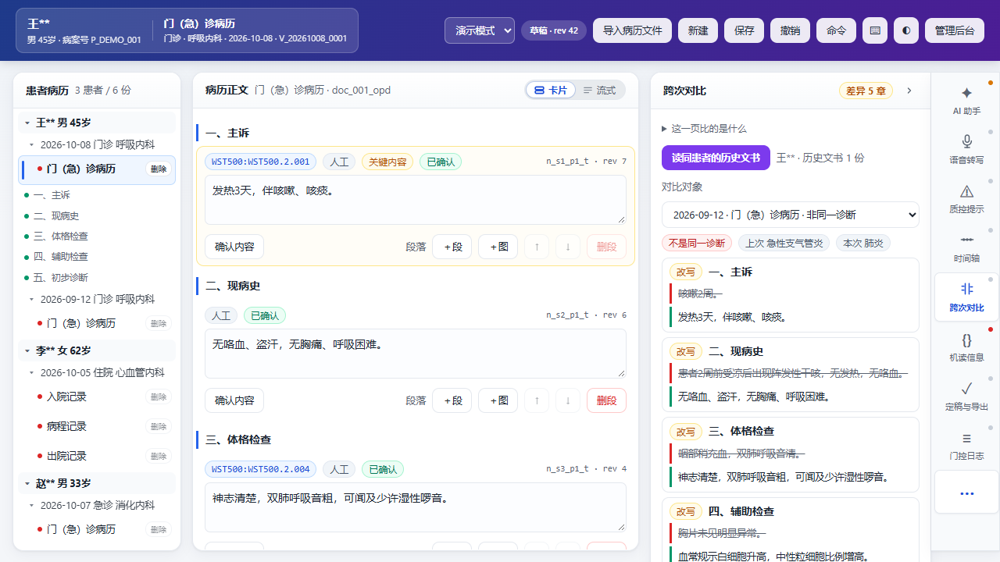
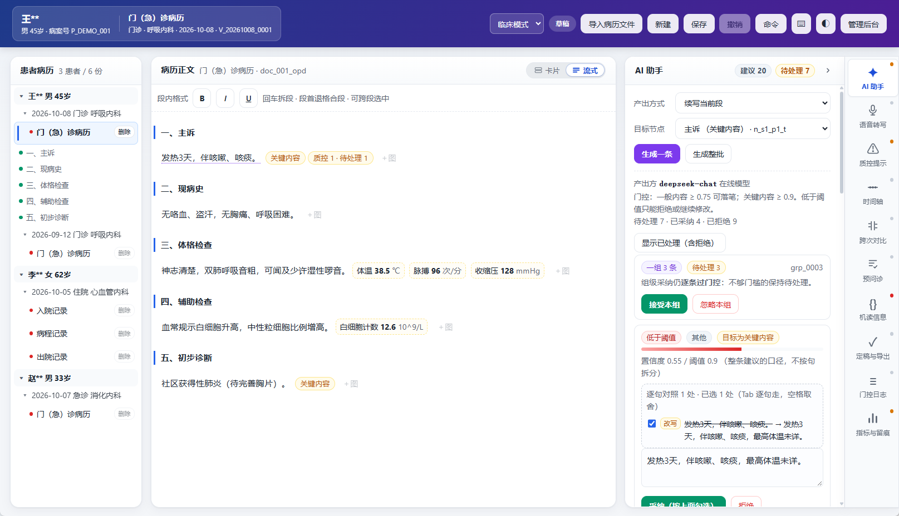
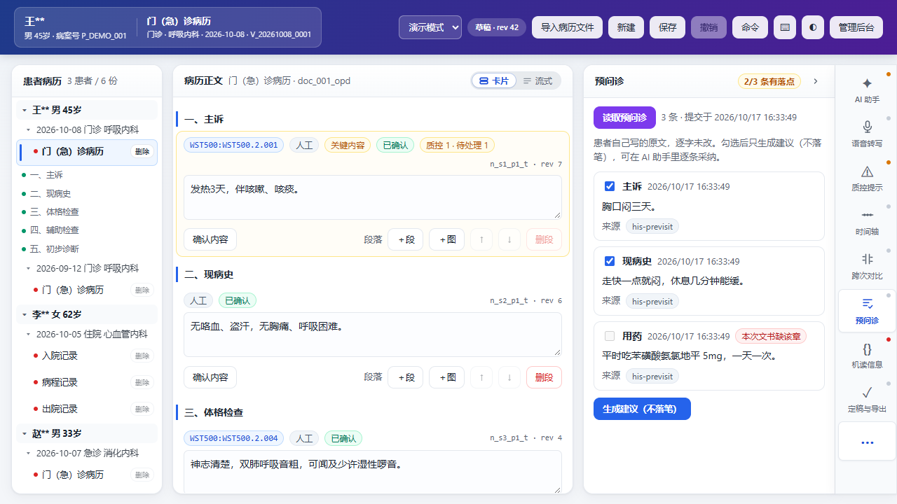

# emr-l0-core · 电子病历编辑器 L0 内核

面向医院电子病历的**L0 内核 + 上层能力**实现。

一个**可验证**的电子病历编辑内核：模型层与写路径、AI 门控、留痕链、机读信息、国密签章、OFD-H / WS/T 500 导出与导入、受控阅读与审计报告。
扩展的上层能力：AI助手、语音转写、质控、时间轴、预问诊、出院汇总、知识资产（模板库、规则库、专科控件）。

- **零运行时依赖**：只用 Node 内置模块，没有 `node_modules`、没有构建步骤
- **Node ≥ 22.9**（直接用 `node` 执行 `.ts`；实测 Node v24.20.0）
- **78 个自测脚本 / 1052 条用例**，
  外加独立探针与真实 HTTP 契约验收

## 快速开始

```bash
npm test              # 全量自测：零依赖，直接跑

npm run demo          # 交互演示 → http://127.0.0.1:8787
npm run serve         # 契约服务端 → http://127.0.0.1:8801
```

## 接入工作站

医生工作站把某个前缀反代到本机（如 `https://ws/emr/` → `127.0.0.1:8787`）时，要告诉本实例它在哪个前缀下：

```bash
L0_BASE_PATH=/emr npm run serve   # 契约服务端同理
```


这是**前端单独嵌进工作站**的前置：不设它，页面能开，但每个脚本与接口都会连到工作站的URI。

## 管理后台

医生端管病历，管理后台管**部署参数**：模型地址（决定病历内容发往哪台服务器）、采集地址
（决定**音频**发往哪台服务器）、签名服务、授权源信任根、落位策略。布局是**左栏 + 内容区**：
左栏放品牌与环境标识、四个分区、公众号二维码（关注「宏医AI」）、当前身份与退出；页头只留标题与一行说明。
版式上：表单宽度**跟语义走**（数字窄、地址宽、宽屏两列）、卡片顶部是**摘要 chip 行**、
危险操作独立在右侧并二次确认、长值**换行显示全不截断**。四个分区：

| 分区       | 内容                                                                                                   |
| ---------- | ------------------------------------------------------------------------------------------------------ |
| 能力配置   | 模型 / **语音（转写与采集，单页）** / **预问诊接入** / 知识资产 / 质控 / 医院签名服务 / 受控阅读授权源 |
| 运行状态   | 签名服务与模型的探测留档（最近一次结论 + 成功/失败计数）、进程与容量                                   |
| 审计与安全 | 管理动作审计：**哪一格从什么改成什么**；登录成功与失败也在内                                           |
| 系统信息   | 版本 / 环境标识 / 数据目录 / **账号来源** / **生效配置指纹**                                           |

```bash
npm run demo          # 打开 http://127.0.0.1:8787/admin —— 未登录会被送到独立登录页 /login
```

### 忘记口令 / 增删账号

```bash
npm run user -- list                       # 列出账号（不含任何口令材料）
npm run user -- passwd admin               # 重设口令（口令从标准输入读，也可用 L0_NEW_PASSWORD）
npm run user -- add dr-zhang clinician     # 新增账号
npm run user -- disable dr-zhang           # 停用（启用：enable）
```

## 目录结构

```
src/
  model/     模型层、索引、机读信息、跨文书一致性、患者主索引
  core/      写会话（门控 / 留痕 / 签章 / 快照持久化）、建议与注解、审计报告
  crypto/    SM3、SM2、SM4 封装、签名与验签、认证加密信封
  ai/        模型接入层（离线模板与 HTTP 适配器、上下文包）
  content/   内容层：可复用的内容段落与常用语（个人 / 科室 / 全院三档，插进已开文书）
  sign/      医院签名服务配置与远程签名器
  import/    OFD / WS/T 500 导入、版式段落重建、ZIP 读取
  export/    OFD-H 与 WS/T 500 导出
  reading/   受控阅读（授权凭据、密钥交付）
  qc/        形式类质控规则包
  demo/      交互 Demo（服务端 + 界面 + UI 契约自测）
  server/    契约验证用的参考服务端
  security/  发布前隐私与密钥排查
tools/       独立探针与参考实现（ofd-check / model-check / editor-check）
schema/      文档模型 schema（`l0-document-model.schema.json` + TS 类型定义）
samples/     内置知识包与质控规则的样例资产（`packs/`、`qc/`）
docs/        能力矩阵与界面截图（`docs/images/`）
artifacts/   **不入库**：跑自测与 Demo 时自动生成（导出样例、探针报告、运行期状态）
```

根目录这两个文件**不能挪位置**，代码是按仓库根拼路径读它们的：
`hongyi-ai-qr.jpg`（`src/demo/demo-server.ts` 的 `/hongyi-ai-qr.jpg`）、
`phi-scan.reviewed.json`（`npm run scan:phi` 的复核记录）。
`.env` 是管理后台口令，**不入库**（见 `.gitignore`）。

## 界面截图

| 医生端                                         |                                      |
| ---------------------------------------------- | ------------------------------------ |
|        | 文档编辑态                           |
|          | 流程模式（纸面上显示节点 id 与 rev） |
|             | 预问诊                               |
|  | 出院小结                             |

截图里的患者数据**全部为虚构**（姓名掩码、身份类号码合成）。

## 参与与安全

- 安全边界与漏洞报告：见 [`SECURITY.md`](SECURITY.md)
- 提 PR 前读 [`CONTRIBUTING.md`](CONTRIBUTING.md)：改了行为就要有自测、提交前跑 `npm run scan:phi`、
  运行产物不入仓
- 第三方声明与 Required Notice：见 [`NOTICE.md`](NOTICE.md)

## 许可

**PolyForm Noncommercial License 1.0.0** —— 全文见 [`LICENSE`](LICENSE)（SPDX：`PolyForm-Noncommercial-1.0.0`）。
版权：**Copyright (c) 2026 宏医AI**（PolyForm 要求的 `Required Notice:` 行同时写在 `LICENSE` 与
[`NOTICE.md`](NOTICE.md) 里 —— 转发任何一部分都要带上它）。

**个人学习、研究、实验、业余项目、以及非营利组织 / 教学机构 /
公立研究机构 / 公共安全与卫生机构 / 政府机构的使用都是免费的；任何商业用途都不被允许。**

不被允许的商业用途包括（不限于）：拿去**投标**、接进院内生产系统、做成 SaaS 或托管服务对外提供、
集成进商业产品对外销售 —— 这些都需要**另行取得书面授权**。

商用授权与咨询：关注公众号「宏医AI」后台留言。
